<div align="center">

<h1>🌍 EuroSAT</h1>
<h3>Klasifikasi Tutupan Lahan Citra Satelit Sentinel-2</h3>

<p>
<strong>EfficientNet-B0 · Grad-CAM · Confidence Threshold</strong><br>
Proyek UTS Pembelajaran Mendalam · Kelompok 8<br>
Semester Ganjil · Tahun Akademik 2026/2027
</p>

<p>
<a href="https://huggingface.co/spaces/fikriianwarr/eurosat-kelompok8"></a>
<a href="notebooks/PROYEK_UTS_DEEP_LEARNING_KELOMPOK_8.ipynb"></a>
<a href="https://huggingface.co/spaces/fikriianwarr/eurosat-kelompok8/tree/c7ee9ead8b00a67c1a861dbbaadb8ae0f80540b6"></a>
</p>

<p>


</p>

<p>
<a href="#ringkasan">Ringkasan</a> ·
<a href="#hasil">Hasil</a> ·
<a href="#demo">Demo</a> ·
<a href="#menjalankan">Cara Menjalankan</a> ·
<a href="#deployment">Deployment</a> ·
<a href="#anggota">Anggota</a>
</p>

</div>

<a name="ringkasan"></a>

## 🔎 Ringkasan Proyek

Proyek ini mengklasifikasikan citra Sentinel-2 ke dalam sepuluh kategori tutupan lahan menggunakan EuroSAT RGB. CNN dasar dipakai sebagai pembanding, sedangkan EfficientNet-B0 dengan transfer learning menjadi model aplikasi. Grad-CAM membantu meninjau kontribusi visual dan confidence threshold menentukan apakah sebuah prediksi diterima.

| Accuracy test Run A | Macro-F1 Run A | Selective accuracy | Coverage test |
|:---:|:---:|:---:|:---:|
| **94,40%** | **0,9431** | **99,61%** | **69,75%** |

**Cakupan metrik:** accuracy 94,40% dihitung atas seluruh 4.050 citra test. Selective accuracy 99,61% dihitung hanya pada 2.825 prediksi yang diterima threshold, dengan coverage 69,75%. Semua angka utama tersebut mengacu pada **Run A**.

| Komponen | Implementasi yang digunakan |
|---|---|
| Model utama | EfficientNet-B0 pretrained ImageNet, lalu fine-tuning pada EuroSAT RGB |
| Pembanding | CNN dasar yang dilatih dari awal |
| Dua fitur tambahan | Grad-CAM dan confidence threshold |
| Aplikasi publik | Hugging Face **Static**; ONNX Runtime Web pada CPU browser |
| Aplikasi Python lokal | Gradio pada `app.py`, menggunakan checkpoint Run A |
| Pengujian ulang | Run B pada Colab, dicatat terpisah dari model publik |

Aplikasi publik memproses gambar di perangkat pengunjung. Model dan runtime diunduh ketika halaman dimuat; inferensi tidak memerlukan server Python atau ZeroGPU.

<a name="navigasi"></a>

## 🧭 Navigasi Dokumentasi

| Memahami proyek | Menjalankan dan memeriksa |
|---|---|
| [Masalah dan tujuan](#masalah) | [Demo dan contoh prediksi](#demo) |
| [Dataset dan preprocessing](#dataset) | [Gradio lokal](#menjalankan) |
| [Arsitektur dan pelatihan](#model) | [Eksperimen lokal dan Colab](#eksperimen) |
| [Hasil eksperimen utama](#hasil) | [Deployment Static dan ekspor](#deployment) |
| [Grad-CAM dan threshold](#fitur) | [Lingkungan dan dependensi](#lingkungan) |
| [Pengujian ulang Run B](#run-b) | [Pengujian dan identitas artefak](#pengujian) |
| [Anggota dan tautan](#anggota) | [Struktur repository](#struktur) |
| [Keterbatasan](#keterbatasan) | [Referensi](#referensi) |

<a name="masalah"></a>

## 🎯 Masalah dan Tujuan

Tutupan lahan memiliki pola visual yang dapat saling menyerupai: vegetasi, lahan pertanian, jalan, serta area permukiman tidak selalu mudah dibedakan dari citra RGB 64 × 64 piksel. Resolusi terbatas, variasi orientasi, dan perbedaan jumlah sampel antarkelas menjadi tantangan klasifikasi.

Tujuan eksperimen adalah membandingkan CNN dasar dengan EfficientNet-B0 pada pembagian data yang sama, meninjau prediksi benar maupun salah menggunakan Grad-CAM, dan mengukur perubahan ketepatan serta cakupan ketika confidence threshold diterapkan.

Hasilnya merupakan bukti pada protokol EuroSAT yang diuji. Split acak berdasarkan berkas belum membuktikan generalisasi ke wilayah geografis yang berbeda.

<a name="dataset"></a>

## 🛰️ Dataset dan Preprocessing

[EuroSAT RGB versi 2](https://zenodo.org/records/7711810) berisi **27.000 citra Sentinel-2 RGB berukuran 64 × 64 piksel**. Kelasnya adalah AnnualCrop, Forest, HerbaceousVegetation, Highway, Industrial, Pasture, PermanentCrop, Residential, River, dan SeaLake. Jumlah citra per kelas berkisar 2.000–3.000.

Data dibagi secara stratified dengan seed 42 menjadi **18.900 training, 4.050 validation, dan 4.050 test**. Kedua model menggunakan manifest pembagian yang sama. Audit berkas tidak menemukan citra rusak atau pasangan duplikat byte-identik; audit ini tidak meniadakan kemiripan antarcitra maupun kedekatan geografis.

Pipeline masukan menggunakan RGB, resize bicubic 64 × 64, rescale intensitas ke rentang 0–1, lalu normalisasi ImageNet dengan mean `[0.485, 0.456, 0.406]` dan std `[0.229, 0.224, 0.225]`. Parameter normalisasi mengikuti bobot pretrained. Augmentasi hanya diterapkan pada training: horizontal flip dan vertical flip masing-masing dengan probabilitas 0,5, serta rotasi acak −20° hingga +20° dengan interpolasi bilinear dan fill RGB `(124, 116, 104)`. Validation, test, dan inferensi tidak memakai augmentasi acak.

Manifest dan audit tersedia pada [artifacts/eda/](artifacts/eda/). Folder dataset tidak disertakan dalam repository.

### Jumlah citra per kelas

| Kelas | Jumlah | Kelas | Jumlah |
|---|---:|---|---:|
| AnnualCrop | 3.000 | Pasture | 2.000 |
| Forest | 3.000 | PermanentCrop | 2.500 |
| HerbaceousVegetation | 3.000 | Residential | 3.000 |
| Highway | 2.500 | River | 2.500 |
| Industrial | 2.500 | SeaLake | 3.000 |

**Total: 27.000 citra.** Kelas terbesar memiliki 1,5 kali jumlah citra kelas terkecil. Evaluasi memakai metrik macro agar setiap kelas memperoleh bobot yang sama pada perhitungan rata-rata.

<details>
<summary><strong>Lihat distribusi kelas, contoh citra, dan histogram RGB</strong></summary>

#### Distribusi kelas

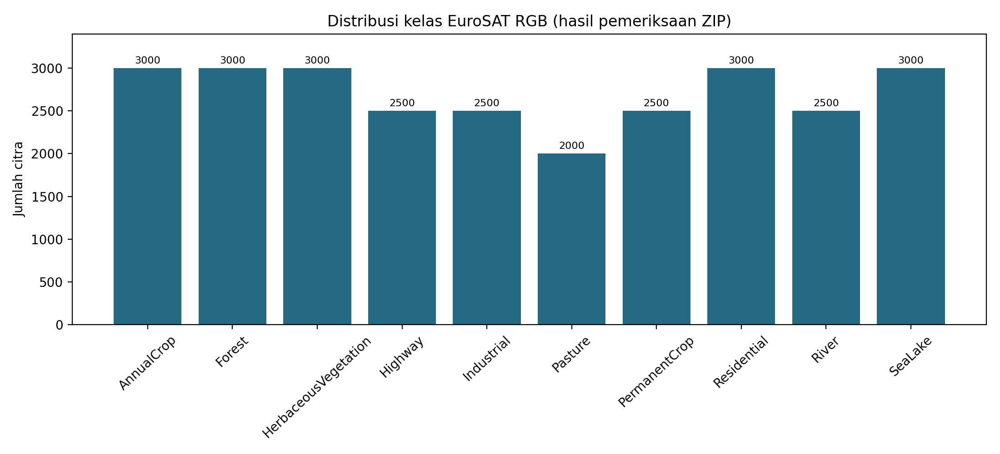

#### Contoh citra dari sepuluh kelas

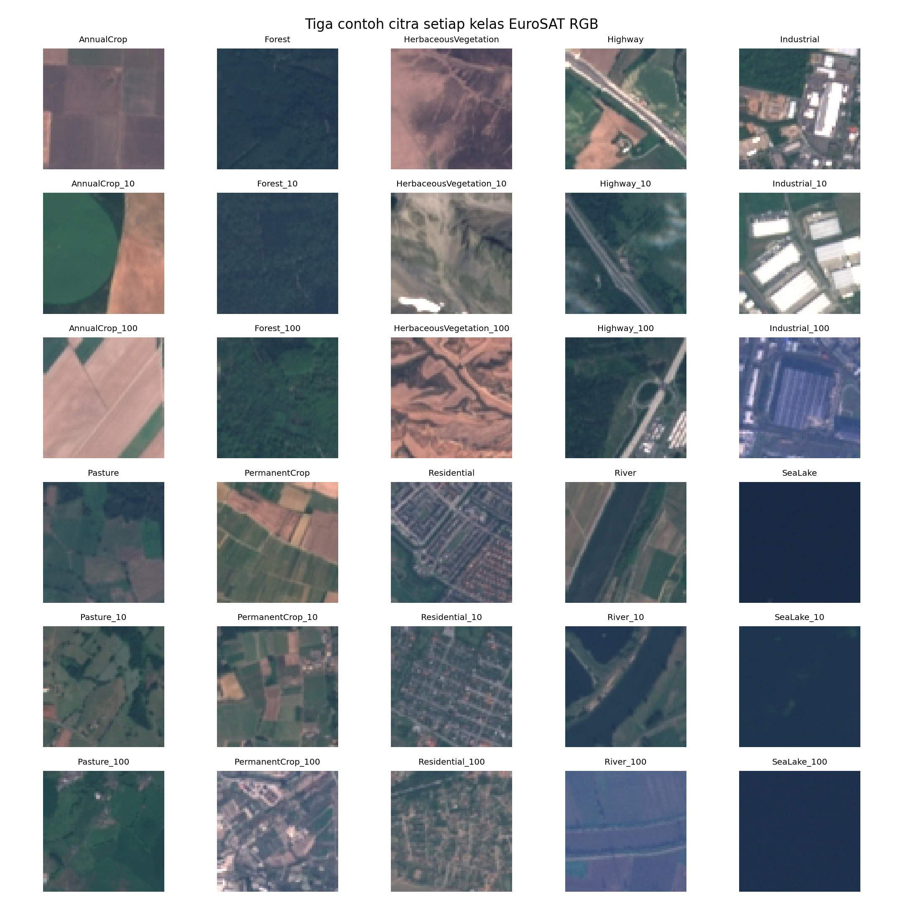

#### Histogram intensitas RGB

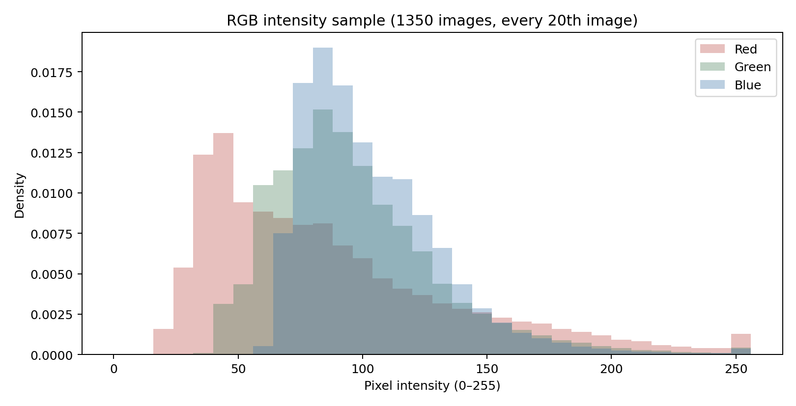

Histogram pada 1.350 citra sampel menggambarkan variasi intensitas kanal. Normalisasi ImageNet dipakai untuk menjaga kesesuaian dengan bobot pretrained; histogram tersebut tidak membuktikan bahwa normalisasi ini optimal untuk EuroSAT.

</details>

<a name="model"></a>

## 🧠 Arsitektur dan Pelatihan

| Komponen | CNN dasar | EfficientNet-B0 |
|---|---|---|
| Masukan | RGB 64 × 64 | RGB 64 × 64 |
| Desain | Empat blok Conv2d–BatchNorm–ReLU–MaxPool, global average pooling, dropout, dan classifier 10 kelas | Backbone pretrained ImageNet, dropout 0,3, dan Linear 1280 → 10 |
| Jumlah parameter | 316.970 | 4.020.358 |
| Tahapan | Dilatih dari awal, maksimal 8 epoch | Head maksimal 5 epoch dengan backbone dibekukan, dilanjutkan fine-tuning maksimal 8 epoch |
| Learning rate | 5 × 10⁻⁴ | Head 10⁻³; fine-tuning 5 × 10⁻⁵ |
| Early stopping | Patience 4 | Head patience 3; fine-tuning patience 4 |

Kedua model memakai AdamW, weight decay 10⁻⁴, cross-entropy, batch size 64, dan seed 42. Checkpoint dipilih berdasarkan **macro-F1 validation**. Threshold ditetapkan dari validation sebelum evaluasi test. Konfigurasi tersedia pada [experiment_config.json](experiment_config.json), sedangkan implementasi terdapat pada [src/models.py](src/models.py) dan [src/train.py](src/train.py).

### Diagram arsitektur

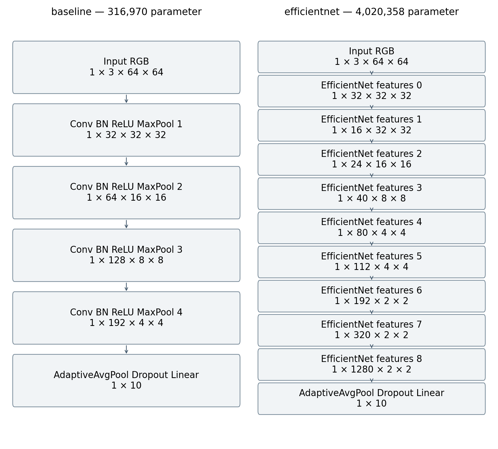

Input asli 64 × 64 dipertahankan pada kedua CNN, sehingga protokol ini berbeda dari preset ImageNet 224 × 224. Diagram dan [rincian arsitektur](artifacts/eda/architecture_details.json) mencatat ukuran tensor serta jumlah parameter.

<a name="hasil"></a>

## 📊 Hasil Eksperimen Utama Run A

Metrik berikut dihitung melalui evaluasi Python pada **4.050 citra test** dan merupakan acuan model aplikasi publik.

| Model | Accuracy test | Macro precision | Macro recall | Macro-F1 |
|---|---:|---:|---:|---:|
| CNN dasar | 88,07% | 0,8928 | 0,8789 | 0,8807 |
| EfficientNet-B0 | **94,40%** | 0,9444 | 0,9425 | 0,9431 |

EfficientNet-B0 meningkatkan accuracy sebesar **6,32 poin persentase** dibandingkan CNN dasar pada protokol ini. Rincian per kelas, confusion matrix, learning curves, probabilitas, dan checkpoint tersedia pada [hasil CNN dasar](artifacts/eksperimen/baseline/) dan [hasil EfficientNet-B0](artifacts/eksperimen/efficientnet/).


### Perbandingan model

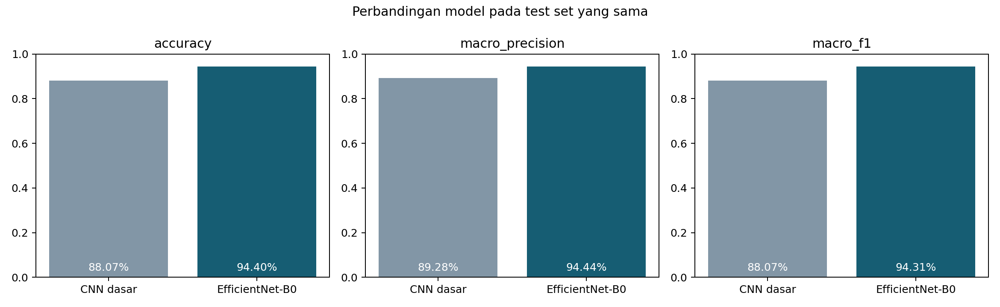

<details>
<summary><strong>Lihat learning curves dan confusion matrix</strong></summary>

#### CNN dasar

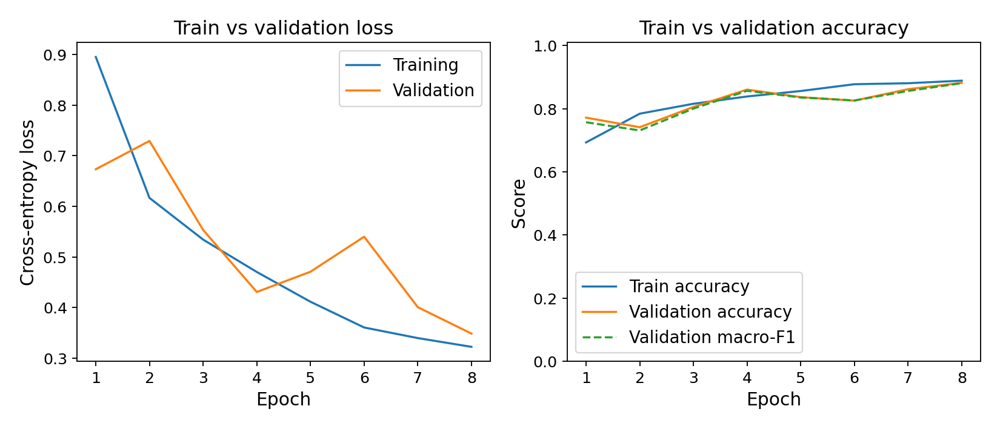

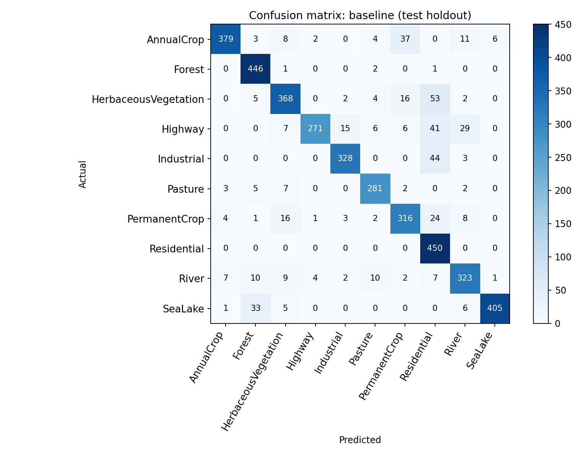

#### EfficientNet-B0

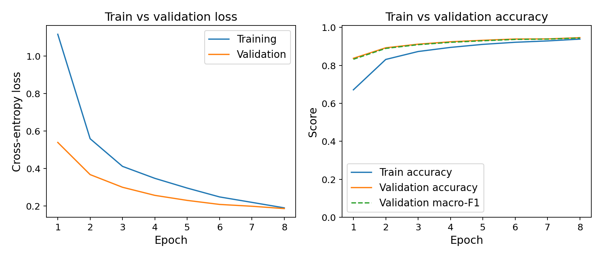

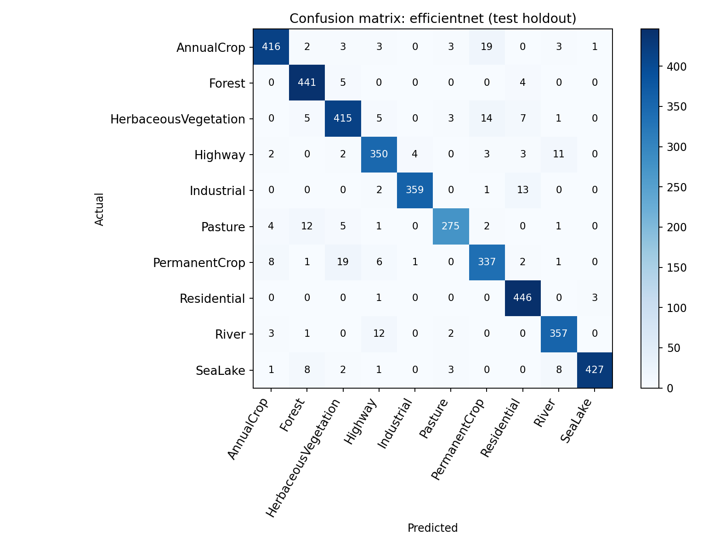

Grafik tersebut berasal dari Run A, yaitu eksperimen yang menghasilkan checkpoint aplikasi publik.

</details>

### Temuan evaluasi

EfficientNet-B0 mengurangi kesalahan dibandingkan CNN dasar pada split yang diuji. Pada Run A, kesalahan yang menonjol mencakup PermanentCrop → HerbaceousVegetation dan AnnualCrop → PermanentCrop, masing-masing 19 citra, serta HerbaceousVegetation → PermanentCrop sebanyak 14 citra. Kemiripan vegetasi dan tekstur merupakan kemungkinan penjelasan, bukan penyebab yang sudah dibuktikan.

Checkpoint EfficientNet-B0 terpilih pada epoch 8 mencatat training accuracy 93,85% dan validation accuracy 94,62%. Training memakai augmentasi serta dropout, sedangkan validation memakai mode eval. Selisih kedua kurva perlu dibaca dengan perbedaan prosedur tersebut; satu seed belum cukup untuk mengukur kestabilan generalisasi.

<a name="fitur"></a>

## 🔬 Dua Fitur dan Bukti Dampaknya

### 1. Confidence threshold

**Kebutuhan dan implementasi.** Model dapat menghasilkan prediksi yang kurang meyakinkan. Skor softmax tertinggi dibandingkan dengan threshold yang dipilih dari validation; skor di bawah ambang ditolak. Mekanisme ini mengurangi cakupan untuk meningkatkan ketepatan pada subset yang diterima.

Ambang `0.99204021692276` atau **99,2040%** dipilih pada validation dengan syarat coverage minimum 70%. Syarat tersebut berlaku pada validation; coverage test merupakan hasil pengukuran terpisah.

| Skenario EfficientNet-B0 | Accuracy pada prediksi diterima | Coverage test | Diterima | Ditolak |
|---|---:|---:|---:|---:|
| Tanpa penolakan | 94,40% | 100,00% | 4.050 | 0 |
| Dengan threshold | **99,61%** | **69,75%** | 2.825 | 1.225 |

Sebanyak 2.814 dari 2.825 prediksi yang diterima benar; 11 kesalahan masih diterima. Penolakan mencakup 216 prediksi salah dan 1.009 kandidat yang sebenarnya benar. **Accuracy seluruh test tetap 94,40%**; selective accuracy 99,61% hanya berlaku pada subset yang diterima. Angka sumber disimpan dalam [threshold.json](artifacts/eksperimen/efficientnet/threshold.json).

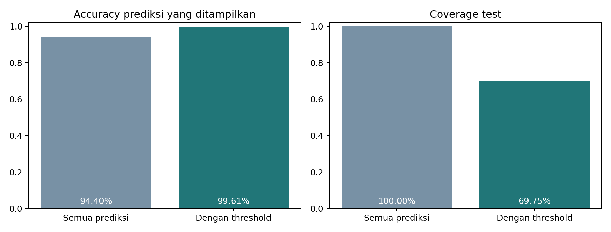

### 2. Grad-CAM

**Kebutuhan dan dampak.** Penjelasan visual membantu meninjau area yang berkontribusi pada skor kelas. Grad-CAM tidak mengubah label hasil model; dampaknya pada proyek ini diperiksa secara kualitatif melalui contoh benar dan salah.

[Implementasi Python](src/interpret.py) menghitung Grad-CAM pada konvolusi terakhir untuk kelas prediksi. Pada [ekspor ONNX](https://huggingface.co/spaces/fikriianwarr/eurosat-kelompok8/blob/c7ee9ead8b00a67c1a861dbbaadb8ae0f80540b6/scripts/export_onnx.py), gradien dihitung secara analitis melalui BatchNorm, SiLU, global average pooling, dan classifier pada mode eval. Probabilitas dan Grad-CAM menjadi keluaran model ONNX.

Grad-CAM membantu meninjau area yang berkontribusi pada skor kelas, termasuk ketika prediksi salah. Peta fitur akhir hanya 2 × 2 sebelum diperbesar; heatmap bersifat kualitatif dan bukan peta segmentasi atau bukti bahwa prediksi benar.

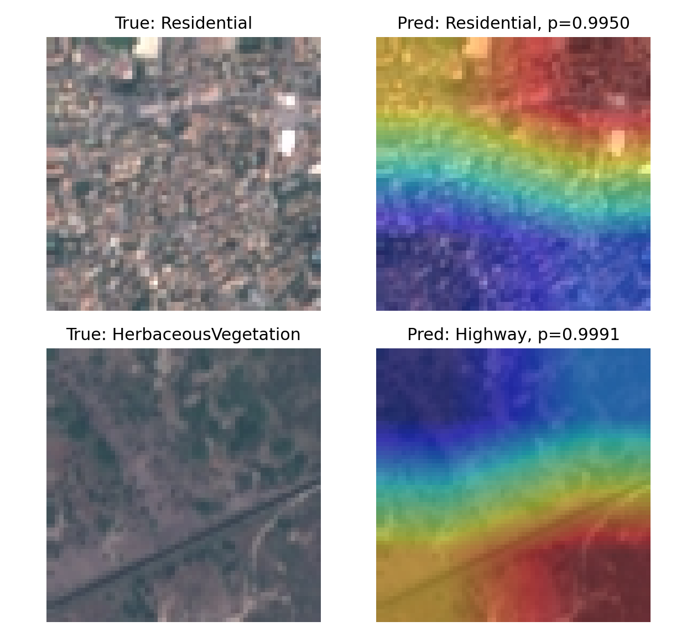

Contoh HerbaceousVegetation yang diprediksi Highway menunjukkan bahwa heatmap tetap bisa dihasilkan saat model salah. Evaluasi threshold dan analisis Grad-CAM menjawab pertanyaan yang berbeda: penerimaan prediksi dan kontribusi visual terhadap skor.

<a name="run-b"></a>

## 🔁 Pengujian Ulang Colab Run B

[Notebook Colab terbaru](https://colab.research.google.com/drive/1Wze2-e1V0A_Jp6DzvEgQxxDgTnwOp7Ln?usp=sharing) merupakan eksekusi ulang dengan manifest data yang sama dan lingkungan berbeda. Hasilnya dicatat sebagai Run B, terpisah dari checkpoint Run A yang dipublikasikan.

| Indikator | Run A — model publik | Run B — pengujian ulang Colab |
|---|---:|---:|
| Accuracy CNN dasar | 88,07% | 87,21% |
| Macro-F1 CNN dasar | 0,8807 | 0,8690 |
| Accuracy EfficientNet-B0 | 94,40% | 94,00% |
| Macro-F1 EfficientNet-B0 | 0,9431 | 0,9391 |
| Ambang confidence | 99,2040% | 98,9710% |
| Selective accuracy test | 99,61% | 99,47% |
| Coverage test | 69,75% | 70,30% |
| Test diterima / ditolak | 2.825 / 1.225 | 2.847 / 1.203 |

Run A menggunakan Python 3.12.14, PyTorch 2.5.1+cpu, dan TorchVision 0.20.1+cpu. Output Run B mencatat Python 3.13.18, PyTorch 2.11.0+cpu, dan TorchVision 0.26.0+cpu, juga pada CPU. Perbedaan hasil tidak dapat diatribusikan hanya pada versi library karena belum diuji melalui eksperimen terkontrol dengan beberapa seed. **Checkpoint dan threshold Run B tidak digunakan oleh aplikasi publik.**

<a name="demo"></a>

## 🖥️ Demo Aplikasi Publik

1. Buka [aplikasi EuroSAT](https://huggingface.co/spaces/fikriianwarr/eurosat-kelompok8) dan tunggu status model siap.
2. Pilih salah satu contoh atau unggah citra RGB JPG/PNG.
3. Klik **Analisis citra** untuk melihat probabilitas sepuluh kelas, confidence, keputusan threshold, dan Grad-CAM.

Model serta runtime diunduh saat pemuatan awal. Inferensi kemudian berjalan pada CPU browser menggunakan ONNX Runtime Web 1.22.0, WebAssembly SIMD, dan satu thread. Aplikasi menerima JPG/PNG tanpa area transparan, berukuran maksimal 20 MiB dan 16.777.216 piksel. Jalur deployment ini memakai SDK **Static**, tanpa layanan inferensi Python atau ZeroGPU.

Pengujian publik pada 4 November 2026 menghasilkan:

| Contoh | Label referensi | Kandidat model | Confidence | Keputusan |
|---|---|---|---:|---|
| `correct_Residential_1033.jpg` | Residential | Residential | 99,5003% | Diterima; benar |
| `wrong_HerbaceousVegetation_2664.jpg` | HerbaceousVegetation | Highway | 99,9098% | Diterima; salah |
| `rejected_Pasture_1451.jpg` | Pasture | Pasture | 50,4340% | Ditolak; kandidat benar |

Kasus kedua memperlihatkan bahwa confidence tinggi dapat menyertai kesalahan. Kasus ketiga memperlihatkan bahwa threshold juga dapat menolak kandidat yang sesuai label referensi. Hasil numerik dapat sedikit berbeda antarbackend atau browser.

<details>
<summary><strong>Lihat tiga citra yang digunakan pada demo</strong></summary>

<table>
<tr>
<th>Prediksi benar</th>
<th>Prediksi salah</th>
<th>Confidence rendah</th>
</tr>
<tr>
<td align="center"></td>
<td align="center"></td>
<td align="center">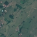</td>
</tr>
<tr>
<td align="center">Residential → Residential<br>Diterima</td>
<td align="center">HerbaceousVegetation → Highway<br>Diterima; salah</td>
<td align="center">Pasture → Pasture<br>Ditolak</td>
</tr>
</table>

</details>

<a name="menjalankan"></a>

## 🚀 Menjalankan Gradio Lokal

Gunakan **Python 3.12 64-bit**. Jika memakai Git, unduh repository terlebih dahulu:

```powershell
git clone https://github.com/fikriianwarr/uts-deep-learning-kelompok8.git
cd uts-deep-learning-kelompok8
```

Jika proyek sudah diperoleh melalui ZIP, ekstrak dan buka PowerShell pada folder yang berisi `app.py`. Kemudian jalankan perintah berikut satu per satu:

```powershell
py -3.12 -m venv .venv
.\.venv\Scripts\python.exe -m pip install --upgrade pip
.\.venv\Scripts\python.exe -m pip install torch==2.5.1 torchvision==0.20.1 --index-url https://download.pytorch.org/whl/cpu
.\.venv\Scripts\python.exe -m pip install -r requirements-validated.txt -r requirements-dev.txt
.\.venv\Scripts\python.exe app.py
```

Buka [http://127.0.0.1:7860](http://127.0.0.1:7860). Checkpoint dan threshold Run A sudah tersedia dalam repository, sehingga dataset tidak diperlukan untuk mencoba tiga contoh bawaan. Biarkan terminal berjalan selama aplikasi digunakan; tekan Ctrl+C untuk menghentikannya.

<details>
<summary><strong>Jika Python 3.12 belum terdeteksi</strong></summary>

Periksa daftar Python yang terpasang:

```powershell
py --list
```

Jika Python 3.12 belum ada, pasang Python 3.12 64-bit terlebih dahulu, buka ulang PowerShell, kemudian periksa `py -3.12 --version`. Lingkungan Gradio lokal ini dipisahkan dari lingkungan ekspor ONNX.

</details>

<a name="eksperimen"></a>

## 📓 Eksperimen Lokal dan Colab

Unduh `EuroSAT_RGB.zip` dari [sumber dataset](https://zenodo.org/records/7711810) dan tempatkan pada `data/EuroSAT_RGB.zip` untuk eksekusi lokal. Setelah dependensi di atas terpasang:

```powershell
.\.venv\Scripts\python.exe scripts/run_experiment.py
```

Skrip menggunakan kembali hasil training yang sudah ada setelah memeriksa konfigurasi dan hash checkpoint; menjalankan perintah ini pada repository berartefak lengkap tidak berarti seluruh model dilatih ulang. Eksperimen baru sebaiknya dilakukan pada salinan kerja terpisah agar artefak Run A tidak tertimpa. Bobot awal ImageNet memerlukan koneksi internet saat belum tersimpan di cache. Checkpoint dan threshold tetap dipilih dari validation.

Untuk Colab, buka notebook `notebooks/PROYEK_UTS_DEEP_LEARNING_KELOMPOK_8.ipynb` dan unggah ZIP dataset sesuai bagian persiapan. Modul proyek tertanam pada notebook, sehingga tidak perlu mengunggah setiap berkas `src/` secara terpisah. Jalankan bagian notebook secara berurutan dan simpan hasil eksekusi sebagai run tersendiri.

### Urutan kerja pada Colab

1. Unggah dan buka notebook `.ipynb` melalui Google Colab.
2. Siapkan `EuroSAT_RGB.zip` sesuai bagian persiapan data pada notebook.
3. Jalankan bagian notebook secara berurutan, termasuk persiapan modul dan validasi data.
4. Simpan output, checkpoint, threshold, dan identitas lingkungan hasil eksekusi tersebut sebagai satu run.
5. Pertahankan label run saat membandingkan hasil dengan model publik.

Runtime Colab dapat memakai versi library yang berbeda. GPU tidak diperlukan untuk memakai aplikasi publik; output Run B yang dibahas di README ini tercatat menggunakan CPU.

<a name="deployment"></a>

## ☁️ Sumber dan Reproduksi Deployment Static

Berkas deployment dapat ditinjau melalui [commit Space yang digunakan dalam laporan](https://huggingface.co/spaces/fikriianwarr/eurosat-kelompok8/tree/c7ee9ead8b00a67c1a861dbbaadb8ae0f80540b6):

| Berkas atau folder pada Space | Fungsi |
|---|---|
| `index.html` dan `assets/style.css` | Antarmuka web |
| `assets/app.js` | Pemuatan model, inferensi, probabilitas, threshold, dan tampilan Grad-CAM |
| `assets/preprocess.js` | Resize bicubic dan normalisasi RGB |
| `assets/vendor/` | ONNX Runtime Web, WASM, lisensi, dan pemberitahuan pihak ketiga |
| `model/eurosat-efficientnet-b0.onnx` | Model FP32 opset 17 yang diekspor dari checkpoint Run A |
| `model/config.json` | Kelas, normalisasi, threshold, hash, dan metrik sumber |
| `model/conversion-validation.json` | Hasil pemeriksaan konversi sebelum publikasi |
| `examples/` | Tiga citra pengujian |
| `scripts/export_onnx.py` dan `scripts/requirements-export.txt` | Ekspor checkpoint PyTorch dan dependensinya |

Untuk memperoleh versi Static yang sama, gunakan Git dan Git LFS yang sudah terpasang:

```powershell
git lfs install
git clone https://huggingface.co/spaces/fikriianwarr/eurosat-kelompok8 eurosat-static
cd eurosat-static
git checkout c7ee9ead8b00a67c1a861dbbaadb8ae0f80540b6
git lfs pull
py -3.12 -m http.server 8000 --bind 127.0.0.1
```

Buka [http://127.0.0.1:8000](http://127.0.0.1:8000); model siap pakai sudah ada pada paket tersebut. Penyajian melalui HTTP diperlukan untuk pemuatan model dan WASM.

Untuk mengulang konversi, dari folder `eurosat-static` buat lingkungan ekspor terpisah. Contoh berikut mengasumsikan clone GitHub berada pada folder saudara bernama `uts-deep-learning-kelompok8`:

```powershell
py -3.12 -m venv .venv-export
.\.venv-export\Scripts\python.exe -m pip install -r scripts/requirements-export.txt
.\.venv-export\Scripts\python.exe scripts/export_onnx.py --checkpoint ..\uts-deep-learning-kelompok8\artifacts\eksperimen\efficientnet\best.pt --threshold ..\uts-deep-learning-kelompok8\artifacts\eksperimen\efficientnet\threshold.json --output model
```

Ekspor memakai PyTorch 2.8.0, TorchVision 0.23.0, dan ONNX 1.19.1, tanpa melatih ulang atau menguantisasi model. Skrip memeriksa kesesuaian hash checkpoint dengan threshold. Pemeriksaan konversi yang tersimpan membandingkan sebelas input dengan PyTorch: selisih absolut maksimum probabilitas 1,85 × 10⁻⁶ dan Grad-CAM 1,52 × 10⁻⁵. Ini merupakan uji konsistensi konversi pada sampel tersebut; metrik keseluruhan test tetap berasal dari evaluasi Python Run A.

Untuk publikasi Static, unggah `index.html`, `README.md` milik paket Space, serta folder `assets/`, `model/`, `examples/`, dan `scripts/` langsung ke root Space. Pertahankan YAML `sdk: static` dan `app_file: index.html` pada README Space. Setelah publikasi, ulangi tiga pengujian dan periksa akses sebagai pengunjung.

`scripts/package_for_space.py` di GitHub menghasilkan paket **Gradio alternatif**. Skrip tersebut tidak menghasilkan aplikasi Static yang digunakan pada tautan publik.

<a name="lingkungan"></a>

## 🛠️ Lingkungan dan Dependensi

| Tahap | Teknologi yang tercatat | Penggunaan |
|---|---|---|
| Pelatihan Run A | Python 3.12.14; PyTorch 2.5.1+cpu; TorchVision 0.20.1+cpu | CPU, 4 thread; menghasilkan bobot model publik |
| Analisis Run A | NumPy 2.2.6; pandas 2.2.3; scikit-learn 1.8.0; Matplotlib 3.10.8; Pillow 11.3.0; tqdm 4.70.1 | Audit, preprocessing, metrik, dan grafik |
| Aplikasi lokal | Gradio 5.49.1 | Antarmuka Python pada `app.py` |
| Pengujian ulang Run B | Python 3.13.18; PyTorch 2.11.0+cpu; TorchVision 0.26.0+cpu | CPU Colab; checkpoint terpisah |
| Ekspor ONNX | PyTorch 2.8.0; TorchVision 0.23.0; ONNX 1.19.1; opset 17 | Konversi bobot Run A ke FP32 ONNX |
| Inferensi publik | ONNX Runtime Web 1.22.0; WebAssembly SIMD | CPU browser, satu thread |
| Hosting | Hugging Face Spaces Static | Menyajikan HTML, CSS, JavaScript, model, dan runtime |

Versi eksperimen utama dicatat dalam [requirements-validated.txt](requirements-validated.txt). Dependensi ekspor tersedia pada [scripts/requirements-export.txt di Space](https://huggingface.co/spaces/fikriianwarr/eurosat-kelompok8/blob/c7ee9ead8b00a67c1a861dbbaadb8ae0f80540b6/scripts/requirements-export.txt). Kedua lingkungan memiliki fungsi berbeda.

<a name="struktur"></a>

## 🗂️ Struktur Repository

| Lokasi | Isi |
|---|---|
| `app.py` | Antarmuka Gradio lokal |
| `src/` | Audit data, preprocessing, model, training, evaluasi, Grad-CAM, threshold, dan inferensi |
| `scripts/` | Eksekusi eksperimen, pembuatan diagram, pemeriksaan integrasi, dan paket Gradio alternatif |
| `notebooks/` | Notebook pipeline eksperimen beserta output tersimpan |
| `artifacts/eda/` | Audit, visualisasi dataset, dan manifest split |
| `artifacts/stage1/` | Hasil pelatihan head EfficientNet-B0 |
| `artifacts/eksperimen/` | Checkpoint final Run A, metrik test, threshold, dan grafik |
| `examples/` | Tiga citra contoh dari test set Run A |
| `tests/` | Pengujian model, preprocessing, data, dan integritas |
| `requirements-validated.txt` | Versi library lingkungan eksperimen utama |

<a name="pengujian"></a>

## ✅ Pengujian dan Identitas Artefak

Jalankan pemeriksaan Python dari root repository GitHub:

```powershell
.\.venv\Scripts\python.exe -m pytest -q
.\.venv\Scripts\python.exe scripts/check_app_integration.py
```

Identitas SHA-256 membedakan bobot, model konversi, dan pembagian data:

| Artefak | SHA-256 |
|---|---|
| Checkpoint EfficientNet-B0 Run A | `313873f1c1a8be382afa8e60a85047effdac4ab214f3037727f158d954bb6b85` |
| Checkpoint EfficientNet-B0 Run B | `c202d11f1522239af1cb8431ff33c6a6c3199c62b6742ebfaf75708ea9e2cfb3` |
| ONNX aplikasi publik | `e93822deb4c482838f4d2256d3cf865265af0b417f33e1518a3b4dd2ff38be32` |
| Manifest split bersama | `3ba6a3aaefdfba8b67e713454a0f10ca012ea8c8b9fc7a543db93a1efd20b1dc` |

Ekspor ulang dapat menghasilkan hash ONNX berbeda bergantung lingkungan ekspor; periksa kembali kesesuaian keluaran dan catat konfigurasi sebelum mengganti artefak publik. Jangan menggabungkan checkpoint suatu run dengan threshold atau metrik dari run lain.

<a name="anggota"></a>

## 👥 Anggota Kelompok

| Nama | NIM |
|---|---|
| Jordanniel Saor Sihombing | 2311120148 |
| Jordani Brema Barus | 231112650 |
| Kevin Rorista Kaban | 231112119 |
| Fadillah Rasyd Barus | 231112885 |
| M. Alfi Syahrin | 231112853 |
| Fikri Anwar | 231112145 |

<a name="tautan"></a>

## 🔗 Tautan dan Artefak Proyek

| Artefak | Lokasi dan fungsi |
|---|---|
| Pelatihan, evaluasi, dan aplikasi Python lokal | [Repository GitHub](https://github.com/fikriianwarr/uts-deep-learning-kelompok8) |
| Aplikasi publik | [EuroSAT Kelompok 8](https://huggingface.co/spaces/fikriianwarr/eurosat-kelompok8) |
| Sumber deployment Static | [Files pada Space](https://huggingface.co/spaces/fikriianwarr/eurosat-kelompok8/tree/c7ee9ead8b00a67c1a861dbbaadb8ae0f80540b6), termasuk HTML, JavaScript, ONNX, konfigurasi, dan skrip ekspor |
| Pengujian ulang Run B | [Notebook Colab](https://colab.research.google.com/drive/1Wze2-e1V0A_Jp6DzvEgQxxDgTnwOp7Ln?usp=sharing); checkpoint ini belum digunakan aplikasi publik |
| Video demo dan deployment | Belum dipublikasikan |

Sumber Static disimpan pada repository Space yang ditautkan di atas, sedangkan sumber pelatihan dan Gradio lokal berada di GitHub. Tautan kode deployment dipatok pada commit yang digunakan dalam laporan agar implementasinya dapat ditelusuri.

Video demo dan deployment merupakan kelengkapan terpisah dari aplikasi yang sudah tersedia. Rekaman perlu memperlihatkan antarmuka publik, contoh prediksi benar dan salah, Grad-CAM, keputusan threshold, serta tahap ekspor, dependensi, unggah, dan uji aplikasi. Tautan video ditambahkan setelah rekaman dipublikasikan dan dapat dibuka tanpa permintaan akses.

<a name="keterbatasan"></a>

## 📌 Keterbatasan dan Cakupan Kesimpulan

Eksperimen menggunakan satu seed dan split acak berdasarkan berkas, sehingga belum membuktikan generalisasi geografis. Citra hanya memiliki kanal RGB dan resolusi 64 × 64. Grad-CAM belum dievaluasi memakai anotasi lokalisasi. Softmax confidence belum merupakan probabilitas terkalibrasi atau pendeteksi input di luar domain yang tervalidasi. Pemeriksaan konversi serta tiga pengujian publik belum menggantikan evaluasi seluruh 4.050 citra test di browser. Aplikasi ditujukan untuk demonstrasi akademis.

<a name="referensi"></a>

## 📚 Referensi

1. P. Helber, B. Bischke, A. Dengel, dan D. Borth. “EuroSAT: A Novel Dataset and Deep Learning Benchmark for Land Use and Land Cover Classification.” 2019. [DOI](https://doi.org/10.1109/JSTARS.2019.2918242).
2. P. Helber dkk. *EuroSAT dataset, Version 2*. [Zenodo](https://zenodo.org/records/7711810).
3. M. Tan dan Q. V. Le. “EfficientNet: Rethinking Model Scaling for Convolutional Neural Networks.” ICML, 2019. [Makalah](https://proceedings.mlr.press/v97/tan19a.html).
4. R. R. Selvaraju dkk. “Grad-CAM: Visual Explanations from Deep Networks via Gradient-based Localization.” ICCV, 2017. [DOI](https://doi.org/10.1109/ICCV.2017.74).
5. PyTorch. [EfficientNet-B0 pada TorchVision 0.20](https://docs.pytorch.org/vision/0.20/models/generated/torchvision.models.efficientnet_b0.html).
6. Hugging Face. [Static HTML Spaces](https://huggingface.co/docs/hub/spaces-sdks-static).
7. ONNX Runtime. [ONNX Runtime Web](https://onnxruntime.ai/docs/get-started/with-javascript/web.html).

<p align="center"><a href="#ringkasan">Kembali ke ringkasan ↑</a></p>
